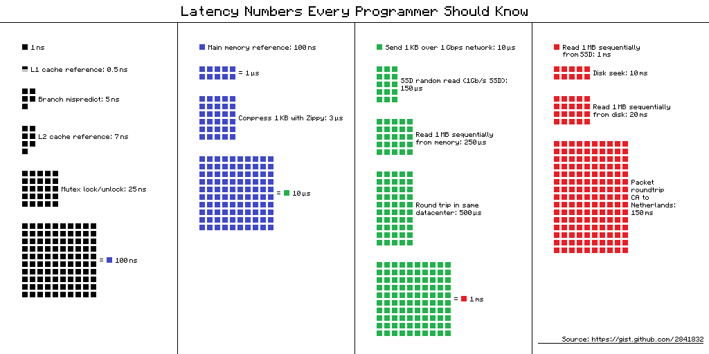
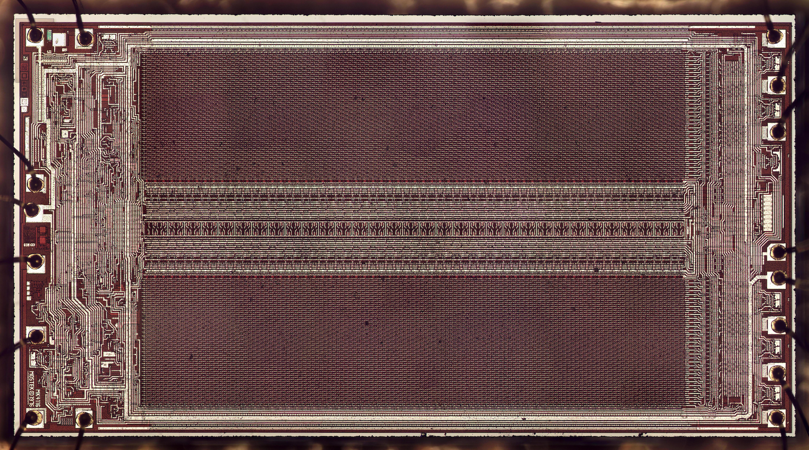
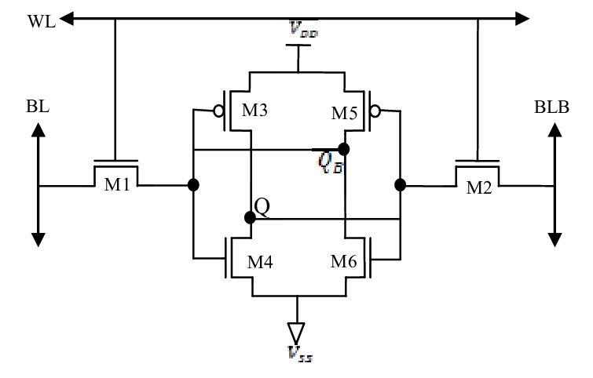

You may have seen this image before:



When I first saw this, my main takeaway was "wow, some things in computers are much faster than others". For example something called "L1 cache reference" takes 0.5 _nanoseconds_ but "main memory reference" takes 100 nanoseconds - i.e. it's 200x slower.

But why is it so much slower? And why is this important? I didn't really have any idea. Until recently, when I read [What Every Programmer Should Know About Memory](https://people.freebsd.org/~lstewart/articles/cpumemory.pdf), a 114 page monster of a paper written by a Red Hat engineer called Ulrich Drepper in 2007. And it turns out that the L1 and L2 caches are crucial to making our computers work at a reasonable speed. Without them, literally every program on our computer would be hundreds of times slower. And some programs already _are_ a hundred times slower than they should be, because they don't use the cache effectively!

I will try to explain what these caches do, why they're faster, and how you can make use of them. A warning: this isn't something you can immediately apply in your day-to-day JS work, because much of it is abstracted from us. But if you want a better foundational understanding of the limits of your computer, this should help. I'm going to skip a lot of details and simplify some things, and probably make some errors, so apologies in advance.

OK so how do we actually store data in a computer? Persistent data lives on our SSD, and in olden times this would have been a hard drive or, I dunno, a magnetic tape. These devices are all relatively slow to read and write data - in the case of the hard drive and tape, it has to physically move components around to reach the data. I don't actually know why SSDs are slow[^1] but the image above tells us that they certainly are. For comparison, a CPU running at 3GHz can execute 3 billion instructions per second[^2], so one instruction takes an average of 0.3 nanoseconds.

Anyway, in order to get stuff done we need to keep data closer to the CPU and be able to access it faster. There are two common ways to do this: DRAM and SRAM.

DRAM (Dynamic Random-Access Memory) is basically made out of two circuit components: a capacitor and a transistor.

```diagram
row selector    
--------------+
              |
             -+-  transistor
             
            -+-+-
bit line     | |      
-------------+ +-------+   
                       |
                      -+-
                           capacitor
                     .-+-.
                    /  |  \
                       |
                       |
                      ground                                         
```

Arranged like this, the capacitor and transistor form a _cell_ and they can store one bit. To store a **1**, we switch on the transistor using the row selector, then charge the capacitor up via the bit line. To read from it, we again switch on the transistor and then discharge the capacitor into the bit line. To store a **0**, we just don't charge the capacitor. This is super simple, small, cheap to manufacture and doesn't use much electrical power. The cells are arranged on a grid so each bit has a unique row and column number, and there are typically 64 grids so we're able to read/write 64 bits at a time. We make main memory chips out of this. The one in my computer is 24GB so has 24 billion of these cells.o

Here's a microscope image of a 16Kb DRAM chip from the 70s. You can see that most of the chip consists of two large uniform grids - these are the DRAM cells.

{.wide}

There are some drawbacks to this design, though. Firstly, the capacitors lose their charge over time. Because they're so small, they often contain only a few thousand electrons, and they will naturally leak their charge out very quickly. Left alone, within a few seconds the capacitors will drain and all data will be lost. So they have to be frequently refreshed, typically every 60ms. While being refreshed, the cell can't be read or written to.

Secondly, since you read a cell by draining its capacitor, you must then recharge it (if it was charged) so it keeps its state.

Thirdly, draining and charging the capacitor takes time, so you have to wait between each operation to be sure that it's in the right state. Say you tried to read the same **1** bit twice in quick succession: if the second read was performed before the capacitor had recharged, it would erroneously read **0** instead of **1**. There are other delays related to selecting the correct row and column of the grid that you want to read from. 

To manage these delays, the chip runs operations on a strict schedule according to a clock. To read or write data, you have to send a series of commands to the chip ("select this row", "select this column") and each command must wait a certain number of clock cycles before the next one. If you're familiar with memory timings from buying a gaming PC, these are literally the number of cycles it takes for these various commands to complete.

If you want even more detail, [this article](https://www.righto.com/2020/11/reverse-engineering-classic-mk4116-16.html) from Ken Shirriff is a fantastic breakdown of the chip pictured above, down to the level of individual transistors.

SRAM (Static Random-Access Memory) is a slightly more complex circuit. It's typically made from 6 transistors and three lines (i.e. tiny wires): the _word line_ and two _bit lines_. The word line controls whether to read or write, and the value is read from/written to the two bit lines. This process is extremely fast - the value is read/written basically instantaneously.



Because it's more complex, SRAM is more expensive to manufacture, and it also consumes more power. It's used for low capacity, high performance memory banks - CPU registers and caches. Because we want the CPU caches to be fast, economics constrains them to be small. My computer has about 30MB of total CPU cache, which is ~0.1% of the main memory.

So this explains why an L1 cache read takes 0.5 nanoseconds but a main memory read takes 100 nanoseconds: they use very different circuitry with different latency characteristics. But what’s the point of such fast memory if it can only store a tiny amount of data? How does the CPU actually make use of this?

They're called caches but really, these SRAM chips are the door through which all data reaches the CPU. L stands for level, and they're numbered from 1 upwards, where 1 is the cache closest to the CPU. Higher level caches tend to have larger capacity but higher latency, I think mostly because they are physically further away.

My computer, an M2 Macbook Air, has 4 "performance" cores and 4 "efficiency" cores. The performance cores each have a 320KB L1 cache and share a 16MB L2 cache. The efficiency cores each have a 192KB L1 cache and share a 4MB L2 cache. There's also an undocumented L3 of sorts, which is probably around 8MB.

```diagram
                          Apple M2

+----------------------------------------------------------+
|     efficiency cores              peformance cores       |
| +----+ +----+ +----+ +----+  +----+ +----+ +----+ +----+ | 
| | E  | | E  | | E  | | E  |  | P  | | P  | | P  | | P  | | 
| +----+ +----+ +----+ +----+  +----+ +----+ +----+ +----+ |
| | L1 | | L1 | | L1 | | L1 |  | L1 | | L1 | | L1 | | L1 | |
| +----+ +----+ +----+ +----+  +----+ +----+ +----+ +----+ |
|                                                          |
| +-------------------------+  +-------------------------+ |
| |                         |  |                         | |
| |            L2           |  |           L2            | |
| |                         |  |                         | |
| +-------------------------+  +-------------------------+ |
|                                                          |
| +------------------------------------------------------+ |
| |                                                      | |
| |                          L3                          | |
| |                                                      | |
| +------------------------------------------------------+ |
|                                                          |
+----------------------------------------------------------+
```

Whenever data is loaded from main memory, it is automatically stored in the caches, both L1 and L2 (this actually isn't always the case and it varies across architectures, but it's a good first approximation). Data is fetched and stored in _cache lines_, which are 64 bytes. Even if you only request 1 byte of data, the CPU will always fetch a full 64 bytes. If the same data is needed again, the CPU will first check the L1 cache, then L2, then fall back to main memory.

If the CPU guesses it will need a particular bit of memory soon, it will prefetch it from main memory and store it in the cache, so when needed it can be fetched quickly.

When data in memory is updated (e.g. your program does `array[i] = "foo"`), the CPU will write a full cache line to the L1 cache. It will write fully down to main memory at some later time.

So in the best case, this makes reads and writes super fast. But it's easy to fall out of the happy path. Let's see how that happens.

Firstly, there's only so much L1 cache. Once it's full, cache lines need to be evicted to make room for new ones. If a program on my computer simultaneously needs access to more than 320KB of data, it's impossible for it to all stay in the L1 cache. You can optimise this, obviously, by just reducing the size of the data you work with - for example if you load a bunch of objects with 10 fields but only use 2 of them, get rid of the other 8. The other important optimisation is to align your data to fit neatly into a 64 byte cache line. This is less relevant in JS land but you may see references to this in high performance code.

Secondly, the initial read of a cache line is only fast if the CPU has correctly guessed and prefetched it. It uses heuristics to do this, so if you access data in a predictable pattern, then it probably will be prefetched. The two friendliest access patterns are reading data in straight sequences (e.g each element of an array, in order) and in constant offsets or "strides" (e.g the first element of each array in an array-of-arrays). But if there's no pattern between the memory addresses, the CPU will struggle to guess the next one. For example, if your data consists of a lot of different objects, all allocated separately, and linked by pointers, then the access pattern may be much more random and it's unlikely that the CPU will have prefetched the next cache line that you need. Sadly this is often the case in JS, because data is stored in large objects managed by the JS engine, allocated individually and linked together by pointers.

When a cache line is modified, it (usually) isn't immediately written back to main memory, it's kept in the L1 cache instead. This is faster, but only works as long as no other core tries to read or write that cache line. If multiple cores access the same chunk of memory, performance degrades drastically.

If one core writes a cache line and another core then reads it, the cache line will have to be flushed from L1 to L2 so that the other core can then load it from L2. Until this flush and load is completed, the second core can't read the data and it may be stalled waiting for it.

If the second core also wants to write to the cache line, things get even more complicated. The CPU doesn't allow two different cores to write to a cache line at the same time. One core must have exclusive write permission. If another core wants to write to the same cache line, it must broadcast to the other cores that it wants exclusive access to that cache line, wait for the other core to relinquish ownership, then load the cache line from a higher cache if it's been modified. If two cores are frequently writing to the same cache line, you end up with a sort of ping-pong effect where they are constantly swapping the cache line between them. This tanks the performance of both cores.

To avoid this you need to minimise the data that you share between threads. This is less relevant to JS because it is single-threaded. A pattern I've seen in some systems is that when using multiple threads for parallelism, they avoid using a shared producer-consumer queue because the threads will contend on the queue. Instead, they will try to split the work up-front and have each thread own a chunk of it, such that they don't need to coordinate.

This is why high performance software (games, databases, networking code) tends to follow these rules:

- Keep data as small as possible
- Keep related data close together, in a predictable layout ("data locality")
- Minimise the data shared between threads

This post is already quite long, so I'll stop there. I've simplified and skipped a lot of details. For example there are actually two L1 caches per core - one for instructions (the code of the running program) and one for data. If you want to dig deeper on any of these topics, here's some links:

- caches can map memory addresses to values in [different ways](https://en.wikipedia.org/wiki/Cache_placement_policies) 
- they also use different eviction policies. I can't find a good article for this, but search "CPU cache eviction policy"
- the model of which core owns which cache line is formally called [MESI](https://en.wikipedia.org/wiki/MESI_protocol)

[^1]: After writing this sentence I did some cursory research and it turns out that SSDs are crazy. Flash memory is made of a special kind of transistor, parts of it are kept at 10 million volts, it physically erodes with every use, and writes data by quantum tunnelling electrons.

[^2]: This is a simplification. Modern CPUs have many individual execution units so they can execute multiple instructions per cycle. Instructions also take different numbers of cycles to complete. Some instructions (e.g. moving data between registers, zeroing registers) take 0 cycles because they can be optimised away. Instructions also need to be decoded, which takes additional cycles but can often be done in advance. So there’s no simple answer but 0.3 nanos is probably the right order of magnitude.
